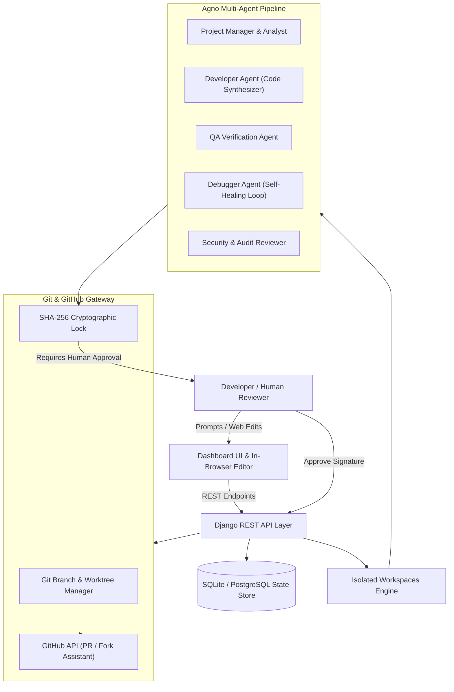

# SENTRIX.ai Architecture & System Design

SENTRIX.ai is an Autonomous Software Engineering platform that bridges **Agno Multi-Agent Intelligence** with **Django Trusted Execution Guardrails**.

## System Overview

## Architectural Boundaries

1. **Guarded Autonomy:** AI agents never have direct permission to push code to remote branches or production without human signature.
2. **Cryptographic Patch Lock:** Every generated unified diff is hashed with SHA-256 (`calculate_patch_hash`). Any modification requires re-hashing and explicit re-approval.
3. **Bounded Repair Loop:** If tests fail in the sandbox, the Debugger and Developer agents collaborate in a bounded 3-cycle repair loop before surfacing the patch.
